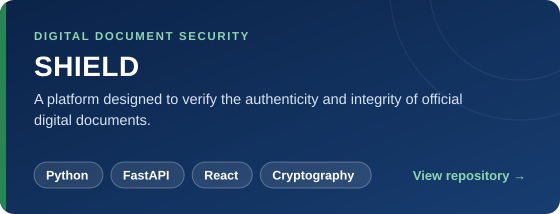
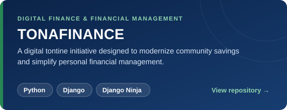
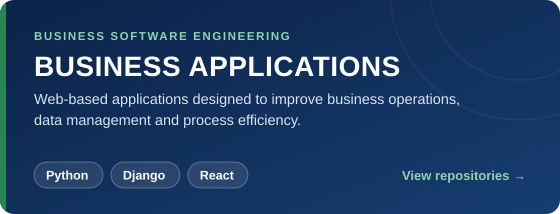

<picture>
  <source media="(prefers-color-scheme: dark)" srcset="./assets/logo-dark.png">
  
</picture>

<h1 align="center">KEITA FLORA</h1>

**Software Engineer &nbsp;|&nbsp; Backend & Full-Stack Developer**
 
Cameroon 🇨🇲

*Engineering with purpose. Building solutions that matter.*

<h2 align="center">About</h2>

I'm a software engineer based in Cameroon, focused on **backend engineering** and **full-stack development**. I enjoy designing clean APIs, structuring applications so they stay maintainable as they grow, and turning real-world problems into reliable software, from the database and the API layer through to the interface and its deployment.

I build web applications and APIs with **Python** (Django, Django REST Framework, FastAPI) and **JavaScript** (React). I care about the details that make software dependable: clear architecture, readable code, disciplined version control and reproducible environments with Docker.

I'm driven by continuous learning and by technology that solves concrete problems for people and businesses. Right now I'm working on **e-learning**, **project management** and **real-time web applications**.

**Backend Engineering** · **Full-Stack Development** · **API Engineering**
 
**Software Architecture** · **Digital Innovation** · **Application Development**

<h2 align="center">Technical Expertise</h2>

| | |
|:--|:--|
| **Languages** |  Python · JavaScript · HTML · CSS |
| **Backend** |  Django · Django REST Framework · FastAPI |
| **Frontend** |  React · Tailwind CSS · Vite |
| **Databases** |  PostgreSQL · SQLite |
| **DevOps & Tools** |  Docker · Git · GitHub · GitLab · Linux · Bash · Postman |
| **Hosting** |  Vercel · Render |

<h2 align="center">Featured Projects</h2>

<!-- TODO: replace each link below with the exact repository URL, e.g. https://github.com/keitaflora01/<repo-name> -->

<h2 align="center">GitHub Analytics</h2>

  

<a href="https://github.com/keitaflora01">
<picture>
  <source media="(prefers-color-scheme: dark)" srcset="https://github-readme-stats.vercel.app/api?username=keitaflora01&show_icons=true&rank_icon=github&border_radius=12&title_color=FFFFFF&text_color=D7E3F4&icon_color=278653&bg_color=0B2348&border_color=173D70">
  
</picture>
</a>

<a href="https://github.com/keitaflora01?tab=repositories">
<picture>
  <source media="(prefers-color-scheme: dark)" srcset="https://github-readme-stats.vercel.app/api/top-langs/?username=keitaflora01&layout=compact&langs_count=8&card_width=495&border_radius=12&title_color=FFFFFF&text_color=D7E3F4&bg_color=0B2348&border_color=173D70">
  
</picture>
</a>

<a href="https://github.com/keitaflora01">
<picture>
  <source media="(prefers-color-scheme: dark)" srcset="https://streak-stats.demolab.com?user=keitaflora01&border_radius=12&background=0B2348&border=173D70&stroke=173D70&ring=278653&fire=278653&currStreakNum=FFFFFF&sideNums=FFFFFF&currStreakLabel=278653&sideLabels=D7E3F4&dates=D7E3F4">
  
</picture>
</a>

<a href="https://github.com/keitaflora01">
<picture>
  <source media="(prefers-color-scheme: dark)" srcset="https://github-readme-activity-graph.vercel.app/graph?username=keitaflora01&custom_title=Contribution%20Activity&bg_color=0B2348&color=D7E3F4&line=278653&point=FFFFFF&area=true&area_color=278653&hide_border=true">
  
</picture>
</a>

<h2 align="center">Contribution Calendar</h2>

<picture>
  <source media="(prefers-color-scheme: dark)" srcset="https://raw.githubusercontent.com/keitaflora01/keitaflora01/output/github-snake-dark.svg">
  
</picture>

<h2 align="center">Have an idea worth building?</h2>

  <em>Let's discuss the challenge, explore the possibilities and engineer something meaningful.</em>

  
  
  

  <a href="https://keita-dev.vercel.app/">Portfolio</a> &nbsp;·&nbsp; <a href="https://twitter.com/keitaflora01">Twitter</a>

<em>Code is poetry. Clean code is a masterpiece.</em>

