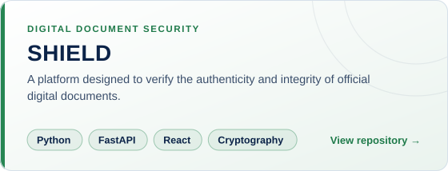
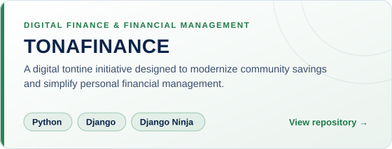
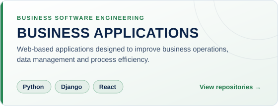
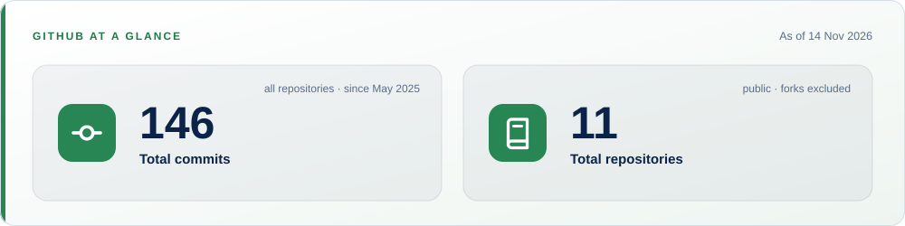

<!--
  Les images utilisent des URL absolues vers le dépôt keitaflora01/readme :
  ce fichier s'affiche donc correctement même copié tel quel dans le dépôt de profil keitaflora01/keitaflora01.
-->

<!-- ═════════════════════════ 1. BANNIÈRE ═════════════════════════ -->

<picture>
  <source media="(prefers-color-scheme: dark)" srcset="https://raw.githubusercontent.com/keitaflora01/readme/main/assets/banner.svg">
  
</picture>

 

  
  
  
  

<!-- ═════════════════════════ 2. ABOUT ME ═════════════════════════ -->

<h2 align="center">About Me</h2>

I'm a **software engineer based in Cameroon**, specialised in **backend engineering** and **full-stack development**. I like designing clean APIs, structuring applications so they stay maintainable as they grow, and taking a product all the way from the database to the interface and its deployment.

<table align="center">
  <tr>
    <td>📍 <b>Location</b></td>
    <td>Cameroon 🇨🇲 — open to remote collaboration</td>
  </tr>
  <tr>
    <td>✉️ <b>Email</b></td>
    <td><a href="mailto:keitafloraprincesses@gmail.com">keitafloraprincesses@gmail.com</a></td>
  </tr>
  <tr>
    <td>🎯 <b>Focus</b></td>
    <td>Backend architecture · REST APIs · Full-stack web applications</td>
  </tr>
  <tr>
    <td>🚀 <b>Currently building</b></td>
    <td>E-learning, project management and real-time web applications</td>
  </tr>
  <tr>
    <td>🌱 <b>Learning</b></td>
    <td>Software architecture patterns, security and cloud deployment</td>
  </tr>
</table>

### My journey

<!-- Ajoute ici ta formation (école, diplôme, années) pour compléter le parcours. -->

- **Foundations** — Started with web fundamentals (HTML, CSS, JavaScript) and Python, building small tools and websites.
- **Backend engineering** — Specialised in Django, Django REST Framework and FastAPI: data modelling, authentication, API design and testing.
- **Full-stack development** — Added React, Tailwind CSS and Vite to ship complete products, from the API to the user interface.
- **Today** — Designing platforms that solve concrete problems: document security, digital finance and business management, with Docker-based, reproducible workflows.

<!-- ═════════════════════════ 3. PROJETS ═════════════════════════ -->

<h2 align="center">Featured Projects</h2>

<!-- TODO : remplace chaque lien par l'URL exacte du dépôt, ex. https://github.com/keitaflora01/<nom-du-depot> -->

<a href="https://github.com/keitaflora01?tab=repositories">
  <picture>
    <source media="(prefers-color-scheme: dark)" srcset="https://raw.githubusercontent.com/keitaflora01/readme/main/assets/projects/shield.svg">
    
  </picture>
</a>
<a href="https://github.com/keitaflora01?tab=repositories">
  <picture>
    <source media="(prefers-color-scheme: dark)" srcset="https://raw.githubusercontent.com/keitaflora01/readme/main/assets/projects/tonafinance.svg">
    
  </picture>
</a>

<a href="https://github.com/keitaflora01?tab=repositories">
  <picture>
    <source media="(prefers-color-scheme: dark)" srcset="https://raw.githubusercontent.com/keitaflora01/readme/main/assets/projects/business-applications.svg">
    
  </picture>
</a>

 

| Project | Objective | Stack | Repository |
|:--|:--|:--|:--:|
| **🛡️ SHIELD** | Verify the authenticity and integrity of official digital documents | Python · FastAPI · React · Cryptography | [View →](https://github.com/keitaflora01?tab=repositories) |
| **💰 TONAFINANCE** | Digitise community savings (tontines) and simplify personal finance | Python · Django · Django Ninja | [View →](https://github.com/keitaflora01?tab=repositories) |
| **🏢 Business Apps** | Improve business operations, data management and process efficiency | Python · Django · React | [View →](https://github.com/keitaflora01?tab=repositories) |

<!-- ═════════════════════════ 4. ENGINEERING STACK ═════════════════════════ -->

<h2 align="center">Engineering Stack</h2>

<picture>
  <source media="(prefers-color-scheme: dark)" srcset="https://raw.githubusercontent.com/keitaflora01/readme/main/assets/tech-marquee.svg">
  
</picture>

  

<table>
  <tr>
    <td align="center" width="170"><b>Languages</b></td>
    <td></td>
  </tr>
  <tr>
    <td align="center"><b>Backend</b></td>
    <td> Django · Django REST Framework · Django Ninja · FastAPI</td>
  </tr>
  <tr>
    <td align="center"><b>Frontend</b></td>
    <td></td>
  </tr>
  <tr>
    <td align="center"><b>Databases</b></td>
    <td></td>
  </tr>
  <tr>
    <td align="center"><b>DevOps &amp; Tools</b></td>
    <td></td>
  </tr>
  <tr>
    <td align="center"><b>Deployment</b></td>
    <td> Vercel · Render</td>
  </tr>
</table>

<!-- ═════════════════════════ 5. GITHUB AT A GLANCE ═════════════════════════ -->

<h2 align="center">GitHub at a Glance</h2>

<a href="https://github.com/keitaflora01?tab=repositories">
  <picture>
    <source media="(prefers-color-scheme: dark)" srcset="https://raw.githubusercontent.com/keitaflora01/readme/main/assets/stats/summary.svg">
    
  </picture>
</a>

<a href="https://github.com/keitaflora01/readme/blob/main/STATS.md">Details &amp; definitions</a> &nbsp;·&nbsp; <a href="https://github.com/keitaflora01?tab=repositories">All repositories</a> &nbsp;·&nbsp; <em>updated daily</em>

<h3>Have an idea worth building?</h3>

<em>Let's discuss the challenge, explore the possibilities and engineer something meaningful.</em>

  

  

<em>Code is poetry. Clean code is a masterpiece.</em>

